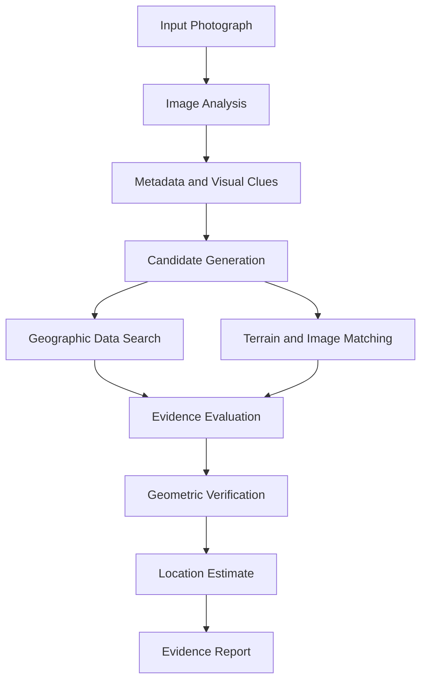

# 🌐 ORBISCOPE
### Geospatial Intelligence & Visual Reasoning

**From pixels to coordinates. From visual clues to verifiable evidence.**

ORBISCOPE is an independent geospatial intelligence project exploring how computer vision, geographic data, terrain analysis, and geometric reasoning can be combined to estimate where a photograph was captured.

The goal is to build a system that goes beyond visual guesses. ORBISCOPE will investigate geographic hypotheses, evaluate candidate locations against measurable evidence, and communicate uncertainty through structured, reproducible reports.

<p align="center">
  <strong>OBSERVE · LOCALIZE · VERIFY</strong>
</p>

---

## Overview

A photograph contains more geographic information than its obvious landmarks. Mountain silhouettes, road geometry, infrastructure spacing, shadows, terrain profiles, and spatial relationships can all constrain the possible location of a camera.

ORBISCOPE aims to turn these observations into a systematic geolocation workflow.

The project is being developed around three principles:

- **Evidence over intuition:** Candidate locations should be supported by observable or computed evidence.
- **Geometry over guesswork:** Spatial relationships, terrain profiles, and camera orientation should help narrow the search.
- **Transparency over false precision:** Results should communicate uncertainty, alternative hypotheses, and the evidence behind each conclusion.

## Project Goals

- Analyze photographs for geographic clues and available metadata.
- Generate and rank plausible candidate locations.
- Use geographic datasets to investigate roads, terrain, infrastructure, and points of interest.
- Explore terrain-profile and skyline matching for landscape geolocation.
- Evaluate visual similarity between photographs and reference imagery.
- Estimate camera position and orientation when sufficient evidence exists.
- Produce structured reports with supporting evidence and uncertainty estimates.

*These are development goals, not claims that every capability is currently implemented.*

## How It Works

ORBISCOPE is planned as a modular investigation pipeline.



### 1. Image analysis

Inspect available metadata, extract visual features, and identify potentially useful clues such as text, infrastructure, terrain, and shadows.

### 2. Candidate generation

Translate observations into geographic hypotheses and identify locations worth investigating.

### 3. Geographic investigation

Use suitable geographic datasets, elevation information, and reference imagery to evaluate candidate locations.

### 4. Evidence evaluation

Compare hypotheses against observed geometry and available data. Keep unsupported assumptions separate from measured or verified evidence.

### 5. Location estimation

When the evidence supports a sufficiently constrained solution, estimate the camera position and orientation and report the remaining uncertainty.

## Proposed Technical Stack

The implementation will be selected and validated as development progresses.

| Area | Planned technologies |
|---|---|
| Core processing | Python |
| Image processing | OpenCV, Pillow |
| Geospatial operations | GeoPandas, Shapely, PyProj |
| Geographic data | OpenStreetMap and suitable public datasets |
| Terrain analysis | Digital elevation models and numerical geometry |
| Visual matching | Feature descriptors and image-embedding models |
| API layer | FastAPI, if a service interface is needed |
| Testing | Pytest and reproducible evaluation datasets |

These technologies are candidates for the architecture. The final dependencies will be documented once they are implemented.

## Architecture Principles

ORBISCOPE is intended to separate its core responsibilities into independent modules.

| Module | Responsibility |
|---|---|
| Image ingestion | Validate inputs and extract available metadata |
| Visual analysis | Identify useful features and observations |
| Geographic search | Retrieve and filter candidate locations |
| Terrain analysis | Compare elevation profiles and visible skylines |
| Geometric reasoning | Evaluate bearings, distances, and camera geometry |
| Candidate ranking | Compare hypotheses against supporting and conflicting evidence |
| Reporting | Present findings, uncertainty, and supporting artifacts |

This separation should make individual algorithms testable, replaceable, and easier to improve without rewriting the entire system.

## Repository Structure

The initial codebase will evolve toward a structure similar to the following:

```text
orbiscope/
├── src/
│   └── orbiscope/
│       ├── ingestion/
│       ├── vision/
│       ├── geospatial/
│       ├── terrain/
│       ├── geometry/
│       ├── ranking/
│       └── reporting/
├── tests/
├── examples/
├── docs/
├── pyproject.toml
├── .gitignore
├── LICENSE
└── README.md
```

The final directory structure will reflect the actual implementation.

## Getting Started

ORBISCOPE is in its initial development stage. Installation and execution instructions will be added when the first working implementation and its dependencies are available.

### Prerequisites

The initial implementation is expected to use:

- Python 3.10 or newer
- Git
- A Python virtual environment
- Additional image-processing and geospatial dependencies as required

### Development setup

Clone the repository:

```bash
git clone https://github.com/ATLURI0001/orbiscope.git
cd orbiscope
```

Create and activate a virtual environment:

```bash
python -m venv .venv
```

On Windows:

```powershell
.venv\Scripts\Activate.ps1
```

On macOS or Linux:

```bash
source .venv/bin/activate
```

Install the project after its package configuration and dependencies have been created:

```bash
pip install -e .
```

Run the project's tests once the test suite is available:

```bash
pytest
```

*These are the intended development commands. They will become executable project instructions once the corresponding files have been added.*

## Evaluation Strategy

A geolocation system should be evaluated against known reference positions, not just by whether its predictions appear plausible.

ORBISCOPE aims to develop an evaluation framework that considers:

- Geographic distance between predicted and reference positions.
- Candidate-ranking performance.
- Performance across different environments and image types.
- Sensitivity to image quality, camera orientation, and missing metadata.
- Confidence calibration and the reliability of uncertainty estimates.
- Reproducibility across repeated runs.

Benchmark results will be published only after the corresponding experiments have been implemented and run.

## Roadmap

- [ ] Establish the project structure and development environment.
- [ ] Implement image ingestion and metadata extraction.
- [ ] Build an initial visual-clue analysis pipeline.
- [ ] Define a geographic candidate representation.
- [ ] Integrate geographic data retrieval.
- [ ] Prototype terrain and geometric matching.
- [ ] Implement candidate ranking and evidence reporting.
- [ ] Create a reproducible test dataset.
- [ ] Evaluate localization error and candidate-ranking performance.
- [ ] Document a working end-to-end demonstration.

## Responsible Use

Image geolocation can reveal sensitive information about locations and activities. ORBISCOPE is intended for legitimate geospatial research, image analysis, and authorized investigations.

Use photographs you own or have permission to analyze. Respect privacy, applicable laws, dataset licenses, and the terms of external imagery services. Do not use the project to track people without their consent or expose sensitive locations.

## Contributing

Contributions will be welcome as the implementation develops.

Useful contributions may include:

- Geospatial algorithms and image-processing improvements.
- Reproducible tests and benchmark datasets.
- Documentation and examples.
- Performance improvements and cross-platform fixes.
- Better uncertainty estimation and evidence visualization.

Contribution guidelines will be added alongside the project's development tooling.

## License

The project's license will be specified in the repository's `LICENSE` file before distribution.

Third-party datasets, models, libraries, and imagery may have separate licensing and attribution requirements. These will be documented as the corresponding dependencies are selected.

---

<p align="center">
  <strong>ORBISCOPE</strong><br/>
  <sub>Geospatial intelligence through visual evidence, geometry, and computation.</sub>
</p>
